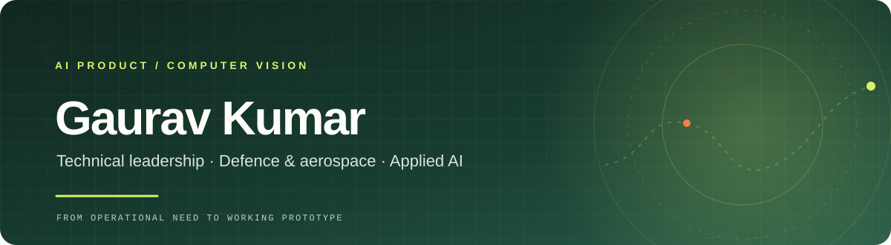

  
   
  <a href="https://gaurav-2210.github.io/gaurav-kumar-portfolio/"><strong>Explore my portfolio ↗</strong></a>
  &nbsp;·&nbsp;
  <a href="https://github.com/Gaurav-2210?tab=repositories">Browse projects</a>

## Hi, I’m Gaurav 👋

**AI/ML Engineer transitioning into AI Product Management.**

I bring 2+ years of hands-on experience building computer-vision products and leading technical delivery. At **Invictron System**, I’ve owned three computer-vision product workstreams, partnered with senior military stakeholders from ideation through prototype demonstrations, translated needs into AI product roadmaps, and led a four-engineer team. Before that, I worked in aviation R&D at **Maviyom Aviation**.

### Product leadership

- **Discover:** clarify stakeholder needs, intended users, constraints, and measurable outcomes
- **Define:** translate broad goals into requirements, scope, priorities, and acceptance criteria
- **Deliver:** align engineering work, manage trade-offs, and keep stakeholders close to progress
- **Validate:** use evaluation evidence to communicate performance, limitations, and next steps

### Selected work

- [GPS-denied navigation](https://gaurav-2210.github.io/gaurav-kumar-portfolio/projects/gps-denied-navigation.html)
- [Drone detection](https://gaurav-2210.github.io/gaurav-kumar-portfolio/projects/drone-detection.html)
- [Thermal human detection](https://gaurav-2210.github.io/gaurav-kumar-portfolio/projects/thermal-human-detection.html)

### Engineering foundation

Computer vision · PyTorch · TensorFlow · OpenCV · YOLO-based detection · model evaluation · TensorRT · ONNX · CUDA · NVIDIA Jetson · Python · SQL · Linux · Git/GitHub

### Selected outcomes

**~25% lower inference latency** · **~18% higher detection accuracy** · **~30% less annotation time** · **120K+ images** across dataset work

At Maviyom Aviation, prior R&D work included a reported **~17% small-object mAP improvement** and **~25 FPS** Jetson Orin Nano deployment at 1280 × 1280.

Figures summarize achievements across workstreams and are not all attributable to one project. Case studies include metric definitions and evaluation caveats where available.

---

  Open to AI Product Management and Technical Product Management roles focused on applied AI.

